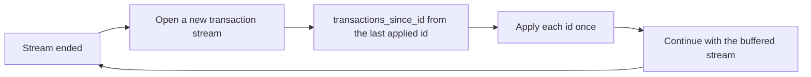

<!--
SPDX-FileCopyrightText: 2026 Kevin Monaghan
SPDX-License-Identifier: MIT-0
-->

# OANDA v20 behaviour guide

> What OANDA v20 and this SDK actually do, in plain words, so you do not have to find out
> the hard way.

## Who this is for

You are wrapping `oanda-client` inside a trading platform, bot or tool, and you want to
know the behaviour that the endpoint pages do not make obvious. Each fact says where it
comes from:

| Tag | Meaning |
| --- | --- |
| **Docs** | Stated on OANDA's public v20 pages, linked inline |
| **SDK** | How this crate behaves, from its source |
| **Seen** | Observed on OANDA Practice accounts in October 2026 while building an integration |
| **Advice** | A choice an integration made that worked; not a fact about OANDA |

"Seen" means it happened in a small number of runs. It is not a promise from OANDA, and
nothing here has been tested on a Live account.

## Connection

### Environments and tokens

| Fact | Source |
| --- | --- |
| Practice and Live each have their own REST host and their own stream host. `Environment` picks both together | [Docs](https://developer.oanda.com/rest-live-v20/development-guide/), SDK |
| Use a token made for the same environment as the account. A token used across environments was not tested | Advice |
| You pass the token in. The SDK never reads files or environment variables, and redacts the token in `Debug` | SDK |
| Call `list_accounts` first and check your account id is in the list. Treat only a 401 on that call as proof the token is bad; a 401 or 403 on one account's endpoint is a refusal for that account | Advice |

### Account modes: hedged and netting

An account is either **hedged** or **netting** (non-hedged). Read `hedgingEnabled` from
`account_summary` or `account_details` before you send any order, and refuse to trade if
it is missing. Do not guess the mode from the account's positions.

| | Hedged (`hedgingEnabled = true`) | Netting (`hedgingEnabled = false`) |
| --- | --- | --- |
| Long and short on one instrument | Both can be open at once, as two sides of one position | One net position per instrument |
| What `positionFill: DEFAULT` does | `OPEN_ONLY`: a sell opens or adds to a short, it does not reduce a long ([Docs](https://developer.oanda.com/rest-live-v20/order-df/)) | `REDUCE_FIRST`: a sell reduces the long first, then opens a short (Docs) |
| To reduce a side | Send `REDUCE_ONLY` on the opposite side; it filled as a reduction (Seen) | `REDUCE_ONLY` is accepted (Seen) |

> [!IMPORTANT]
> On a hedged account, an ordinary sell against a long position opens a new short. If you
> mean "reduce", say `REDUCE_ONLY`.

### Limits

| Limit | Value | Scope | Source |
| --- | --- | --- | --- |
| REST requests | 120 per second; excess gets HTTP 429 | Requesting IP address | [Docs](https://developer.oanda.com/rest-live-v20/development-guide/) |
| Active streams | 20; more are rejected | Requesting IP address | Docs |
| New connections | 2 per second; more are rejected | Client | Docs |
| Recommended request rate on one connection | 100 per second | A recommendation, not a limit | [Docs](https://developer.oanda.com/rest-live-v20/best-practices/) |
| Pricing stream rate | At most 4 prices per second per instrument | Per instrument | [Docs](https://developer.oanda.com/rest-live-v20/pricing-ep/) |

How the SDK enforces them (SDK):

- Every client built with the same `Admission` owner, and every clone, shares one rolling
  120-per-second REST window, one 20-stream count, one 2-per-second connection-start
  budget and one 429 cooldown. Separately built owners and separate processes share
  nothing. If several processes use one IP address, you must coordinate them.
- A read waits for capacity. A mutation that cannot be admitted at once fails with
  `Error::RateLimited` and is never sent. A 21st stream also fails with `RateLimited`.
- After a 429 the SDK pauses every request sharing the owner for `Retry-After` (1 second
  when absent, 60 seconds at most) and returns `Error::ProviderRateLimited`, which carries
  no delay. Nothing is retried.
- Streams do not use REST capacity. Reusing an open connection does not count as a new
  connection; a started connection attempt that fails or is cancelled is still counted.

### Keeping room for exits

The optional exit reserve keeps part of the 120-request window for `cancel_order`,
`close_trade` and `close_position`. It is off by default. See the
[README section](../README.md#optional-exit-reserve) for the API.

A policy that worked (Advice): count the exits you might need (one per cancellable order,
plus one close per account and instrument), cap the reserve at 20, hold the full 20
whenever any account's state is unknown, and release it only when every account sharing
the owner is known flat with no working orders. At 20 reserved, ordinary traffic still has
100 requests per second. The reserve is finite: it cannot recover requests already spent,
and it does not bypass a 429 cooldown or a
[reconciliation fence](#after-an-ambiguous-mutation).

### Streams

Pricing and transaction streams are long HTTP/1.1 responses with one JSON record per line
(SDK, [Docs](https://developer.oanda.com/rest-live-v20/transaction-ep/)).

| Behaviour | Source |
| --- | --- |
| Both streams send a heartbeat every 5 seconds | Docs |
| If no data arrives for 30 seconds, the SDK ends the stream with a transport error | SDK |
| A malformed or oversized record (over 1 MiB), a backlog over 16 MiB, end of file or any read error ends the stream. The SDK never reconnects or skips ahead | SDK |
| Each `HttpStream` is one "generation". After it ends you open a new one and treat the time between as a gap | SDK |
| The SDK bounds the connection attempt, but not the wait for the response headers. Put your own deadline around `stream_pricing` and `stream_transactions` | SDK |
| Some stream opens waited about 21 to 23 seconds and then got HTTP 520. Others opened in under 2.5 seconds. One slow transaction-stream open still succeeded after 23 seconds. The cause is not known | Seen |
| A pricing open sometimes got no reply at all for 15 seconds, while other opens on the same account, before and after, worked | Seen |

What worked for opening streams (Advice, tested against the behaviour above):

1. Give each open its own deadline (4 seconds for pricing worked well).
2. On a timeout, transport error or HTTP 5xx, wait 1 second and retry, up to two times.
3. Never retry an HTTP 4xx; it is a real refusal.
4. Remember that every attempt, including an abandoned one, uses the 2-per-second
   connection budget.

### Shutdown

Drop the `HttpStream` to close it; this frees its stream slot (SDK). There is no logout or
session close in v20. Dropping a stream in the middle of a read is safe.

## Data

### Pricing stream and readiness

| Fact | Source |
| --- | --- |
| The stream is sampled. It does not carry every price | Docs |
| By default it sends a snapshot of the current price when it connects (`snapshot`) | Docs |
| An open stream or a heartbeat does not mean you have a price. Wait for the first price that is `tradeable` before you trade | Seen |
| `bids` and `asks` are liquidity buckets: "this price is good for this amount". They are not order-book levels | [Docs](https://developer.oanda.com/rest-live-v20/pricing-common-df/) |
| A side can be empty; handle it. Do not fill it from `closeoutBid` or `closeoutAsk`: OANDA uses those only to close out positions | Docs |
| `status` is deprecated; use `tradeable` | Docs |
| Adding or removing an instrument means opening a new stream, which is a new generation | SDK |

### Instruments and precision

Read instruments from `account_instruments`; each account can have its own list.

| Field | What it means |
| --- | --- |
| `displayPrecision` | Number of decimal places allowed in a price. More gives `PRICE_PRECISION_EXCEEDED` (Docs) |
| `tradeUnitsPrecision` | Decimal places allowed in units. More gives `UNITS_PRECISION_EXCEEDED` (Docs) |
| `pipLocation` | The pip as a power of ten, for display only |
| `minimumTradeSize`, `maximumOrderUnits` | Order size bounds |
| `maximumPositionSize` | A zero means no limit, not a limit of zero (Seen) |
| `marginRate` | Margin as a fraction of notional |
| `commission` | An amount in the account's home currency per `unitsTraded` units |

Names use an underscore (`EUR_USD`). Every financial value is an exact `Decimal` (SDK).

### Candles and history

| Fact | Source |
| --- | --- |
| Candles are built from bid, mid or ask quotes (`price` = `B`, `M`, `A`). There are no trade-price candles and no trade prints | [Docs](https://developer.oanda.com/rest-live-v20/instrument-df/) |
| `volume` is the number of price updates, not traded quantity | Docs |
| Defaults: mid prices, `S5`, 500 candles. At most 5,000 per request | Docs, SDK |
| Daily and longer candles align to 17:00 America/New_York by default. Set `dailyAlignment` and `alignmentTimezone` if you want UTC days. Times are always returned in UTC | Docs |
| The last candle can still be forming (`complete: false`) | Docs |
| `includeFirst=false` stops you getting the same candle again when you poll from the last one | Docs |
| Treat a reply of exactly 5,000 candles as possibly cut short, and page on from the last one | Advice |
| Treat a missing `candles` array as an error, and an empty array as a valid empty answer | Advice |

### Transaction ids and cursors

Every change to an account is a transaction with an id. The ids only go up within one
account.

- `account_details` returns the account state and the `lastTransactionID` it reflects,
  together. That id is your starting cursor.
- `transactions_since_id` returns everything after (not including) the id you give it,
  plus its own `lastTransactionID` (Docs).
- Each reply's `lastTransactionID` belongs to that reply only. Two reads made at the same
  time came back at different ids (Seen); do not merge them as one picture.
- The docs do not promise there are no gaps between ids, so do not depend on that. Check
  that ids increase.
- The transaction heartbeat carries `lastTransactionID`. If it is ahead of the last id you
  applied, you have missed something.

### Recovering from a gap

The transaction stream starts at the moment you connect; it does not replay the past
(Docs, SDK). This order worked in both account modes (Seen):

Open the new stream **before** reading the backfill, so nothing falls between them. Then
apply each transaction id once; the stream and the backfill overlap.

## Execution

### Orders, trades and positions

| Object | What it is |
| --- | --- |
| Order | A request: market, limit, stop, market-if-touched, or a dependent take-profit, stop-loss, trailing stop or guaranteed stop |
| Trade | One filled lot with its own id, entry price and open units |
| Position | The total of the open trades per instrument, with a long side and a short side |

There is no position stream. You get positions by reading them, or by applying fills
from the transaction stream (Seen). Fills say which trades they opened, reduced or closed
(`tradeOpened`, `tradeReduced`, `tradesClosed`).

### Time in force

| Order type | Allowed | Source |
| --- | --- | --- |
| Market | `FOK`, `IOC` | Docs |
| Limit, stop | `GTC`, `GTD`, `GFD`, `FOK`, `IOC` | Docs |
| Market-if-touched | `GTC`, `GTD`, `GFD` | Docs |

`GFD` ends at 5pm New York time (Docs). v20 has no stop-limit or limit-if-touched order
type.

### Closing positions and trades

| Call | What it closes |
| --- | --- |
| `close_position` with `longUnits: ALL` | Every long trade on that instrument |
| `close_position` with `shortUnits: ALL` | Every short trade on that instrument |
| `close_position` with a number | That many units of the side |
| `close_trade` | One trade, all or some of its units |

> [!WARNING]
> Both `longUnits` and `shortUnits` default to `ALL` ([Docs](https://developer.oanda.com/rest-live-v20/position-ep/)),
> and the SDK leaves out a field you set to `None`. To close one side only, set the other
> side to `NONE` explicitly.

What we saw (Seen):

- `close_position` with `ALL` worked the same way in hedged and netting accounts, for long
  and for short. Three separate one-unit trades were closed by one close, each with its
  own entry in `tradesClosed`.
- A separate pending `REDUCE_ONLY` limit order **survived** the close. It had to be
  cancelled on its own. To flatten, cancel working orders first, then close.
- A `REDUCE_ONLY` `FOK` order larger than the position was cancelled with
  `POSITION_TO_REDUCE_TOO_SMALL`; it did not reduce part of it.
- A flatten of "cancel every working order, then a `REDUCE_ONLY` `IOC` market order per
  open side" left a hedged account flat with no orders.
- `close_position` with `longUnits: ALL` on a hedged account whose long side was already
  flat was refused. OANDA wrote a `MARKET_ORDER_REJECT` transaction with reason
  `POSITION_CLOSEOUT` and `rejectReason` `CLOSEOUT_POSITION_DOESNT_EXIST`, embedded it in the
  rejection reply as `longOrderRejectTransaction`, and moved the transaction cursor.

> [!IMPORTANT]
> That reject carries **no `units`** field, although the docs mark it required. The size you
> asked for is only in `longPositionCloseout` (or `shortPositionCloseout`), as `ALL` or a
> number. The SDK reads the missing units as `None` (SDK); do not read a size from it.

### Dependent orders

Take-profit, stop-loss and trailing stops are attached to a trade, either in `onFill` when
you place the order or later with `set_trade_dependent_orders`. OANDA cancels them when
their trade closes; `LINKED_TRADE_CLOSED` is the cancel reason for this (Docs). We have
not recorded it ourselves.

### Replacing orders and refusals

`replace_order` cancels the old order (`CLIENT_REQUEST_REPLACED`) and creates a **new
order with a new id**, whose `replacesOrderID` points to the old one (Seen). Keep your own
order id and rebind it to the new venue id.

| What we sent | What happened (Seen) |
| --- | --- |
| Limit replaced by a limit, stop or market-if-touched | Accepted, as above |
| Limit replaced by a market order | Refused at once with an invalid-parameter error. No transaction was created, and the original order kept working |
| A replacement with invalid units | A reject transaction with `intendedReplacesOrderID` naming the original order, which kept working |
| Zero units on a market, limit, stop or market-if-touched order | Each refused with `UNITS_INVALID`, as a reject transaction |
| Cancel an order that does not exist | An `ORDER_CANCEL_REJECT` transaction with `ORDER_DOESNT_EXIST` |

> [!NOTE]
> In a refused replacement, `clientExtensions` describe the **proposed** new order, not the
> original. Do not copy them onto the original order.

Some refusals create a reject transaction and move the cursor; others do not. Handle both.

### Fills, money and PnL

Book what OANDA states. Do not recompute it.

| Field | Meaning |
| --- | --- |
| `price` on each trade entry | The exact fill price. The spread is already in it |
| `pl` | Realized profit or loss in the account's home currency. This is what moves the balance |
| `quotePL` | The same in the instrument's quote currency. It differs from `pl` by conversion and rounding |
| `halfSpreadCost` | Information only, in home currency. It is already in the price; do not subtract it again |
| `commission` | Always positive, and it reduces the balance |
| `financing` | Financing paid or collected on this fill |
| `accountBalance` | The balance after this fill |
| `homeConversionFactors` | Deprecated (Docs). It was absent in our recordings; do not rely on it |

What we saw (Seen): `pl` is rounded to the home currency's precision. One fill showed
`pl` -0.0001 against `quotePL` -0.00013. Three closes each stated `pl` -0.0001, summing to
-0.0003, while their `quotePL` summed to -0.00027. So never work out an exchange rate from
`pl` and `quotePL`. Daily financing arrives as its own `DAILY_FINANCING` transaction
(Docs).

### Ordering between REST replies and the stream

- The transaction stream is the record of what happened. A REST success does not mean you
  have applied the fill.
- The REST reply for a mutation came **before** the stream rows in some runs and **after**
  them in others (Seen). Apply by transaction id, once, whichever arrives first.
- A REST reply for a fill carried the same transactions the stream sent (Seen). Use the id
  to drop the repeat.

### After an ambiguous mutation

A mutation is ambiguous when the SDK cannot tell whether OANDA acted on it. The SDK
treats every send error as ambiguous, including a DNS or connect failure before anything
was written, and also a 5xx, a 408, any status other than 400, 401, 403, 404 and 405,
and a reply it could not read, whatever its status. It reports each as
`AmbiguousMutation` and never retries it (SDK). The order may have been placed, filled, or never arrived. OANDA refuses
a new order whose `clientExtensions.id` is already assigned to another *pending* order
(`CLIENT_ORDER_ID_ALREADY_EXISTS`, [Docs](https://developer.oanda.com/rest-live-v20/transaction-df/)),
but nothing stops a duplicate of one that already filled or was cancelled, so a blind
resubmission is not safe (Advice).

The SDK then fences the account (SDK):

- Every later mutation on that account is refused with `ReconciliationRequired` and not
  sent. That includes `cancel_order`, `close_trade` and `close_position`, so a fenced
  account cannot be flattened until you release it.
- The fence is shared by every clone of the client, and it stays until you call
  `acknowledge_reconciliation` for that account. Nothing releases it on its own. A
  client built separately has its own fence, even when it shares the same `Admission`
  owner, so send an account's mutations through clones of one client.
- Dropping a mutation's future after the SDK has reserved the account (your own
  timeout, a `select!` branch losing) fences the account too, because the SDK can no
  longer know whether the request went out.
- A 429 is not ambiguous: OANDA refused it, and the account is not fenced.
- A mutation refused by the fence still spends one admitted request from the window,
  because admission runs before the fence check. For an exit, that request comes from
  the full 120, reserve included.

To release it (Advice):

1. Read every transaction after the last id you applied with `transactions_since_id`,
   and apply each one once, as in [Recovering from a gap](#recovering-from-a-gap).
2. Only then call `acknowledge_reconciliation`. It returns an error if it could not
   release the fence, and the account then stays fenced.
3. Decide from what you read whether the ambiguous order exists, before sending
   anything that depends on it. Match it by the `clientExtensions.id` you sent; an order
   sent without one cannot be told apart afterwards, so set one on every order. A request
   that timed out can still land after your backfill read; keep the transaction stream
   open from before the read, as in step 1, so a late arrival still reaches you.

> [!WARNING]
> If your wrapper never calls `acknowledge_reconciliation`, one ambiguous mutation
> leaves the account unable to cancel or close for the rest of the session. An exit
> path should run step 1 and step 2 first, then send its cancels and closes.

## Wrapping the SDK

| Rule | Why |
| --- | --- |
| Run one `Admission` owner per IP address and pass clones of it to every client | The limits are per IP; independent owners do not see each other (SDK) |
| Send one mutation per account at a time | A second concurrent mutation on the same account fails with `MutationInFlight` (SDK) |
| Treat `AmbiguousMutation` as "unknown", not "failed" | The order may have reached OANDA. The account is fenced, exits included, until you read its transactions and call `acknowledge_reconciliation`; see [After an ambiguous mutation](#after-an-ambiguous-mutation) (SDK) |
| Never retry a mutation automatically | The SDK never does; a blind retry can double an order (SDK) |
| Treat HTTP 5xx, 408, timeouts and unexpected statuses on a mutation as ambiguous | The SDK reports them as `AmbiguousMutation`. A 429 does not fence the account (SDK) |
| Own reconnection | The SDK opens one stream per call and never reconnects (SDK) |
| Bound every stream open yourself, and retry only 5xx and transport failures | See [Streams](#streams) |
| Wait for a tradeable price, not an open stream | See [Pricing stream and readiness](#pricing-stream-and-readiness) |
| Read the account mode first | See [Account modes](#account-modes-hedged-and-netting) |
| Validate prices and units against `displayPrecision` and `tradeUnitsPrecision` before sending | OANDA refuses extra precision; do not round silently |
| Keep the reply's `None` as `None` | A rejection's `code`, `message` and body are only what OANDA sent (SDK) |

## Known gaps

These are not verified. Treat them as open questions.

| Area | Status |
| --- | --- |
| Live accounts | Nothing here is tested on Live |
| Cause of the slow stream opens and HTTP 520 replies | Unknown. Not shown to be OANDA, the network or this SDK |
| Dependent orders (take-profit, stop-loss, trailing, guaranteed stop) | Taken from the docs; not recorded |
| A single order that reverses a netting position through zero | Not recorded. Our reversals went to flat first, then opened the other side |
| Which trade a netting account closes first | Not recorded with more than one open trade |
| `close_position` with one side omitted while the other side is open | Not recorded; see the warning in [Closing positions and trades](#closing-positions-and-trades) |
| A refused `close_trade` or margin closeout | Not recorded. Only the reject for a flat position side is; others may omit fields the docs mark required |
| Size limits of `transactions_since_id` | The docs give none; very large backfills are untested |
| Gaps between transaction ids | Not seen, and not ruled out |
| Several processes on one IP address | The SDK cannot coordinate them |
| Exact 429 thresholds | The SDK paces locally; it does not measure what OANDA enforces |
